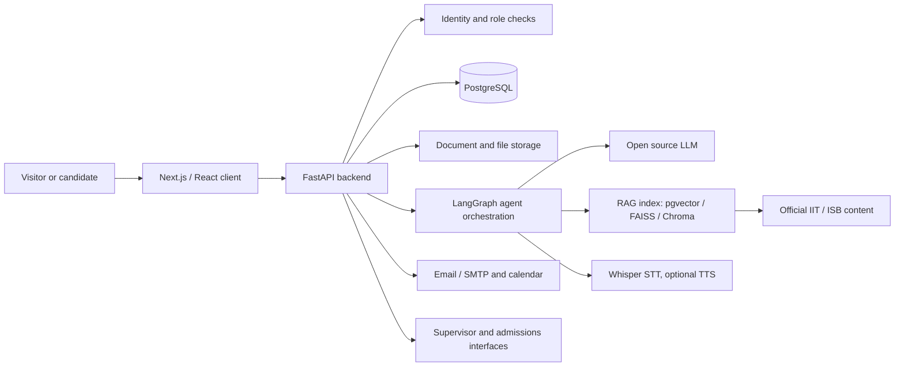
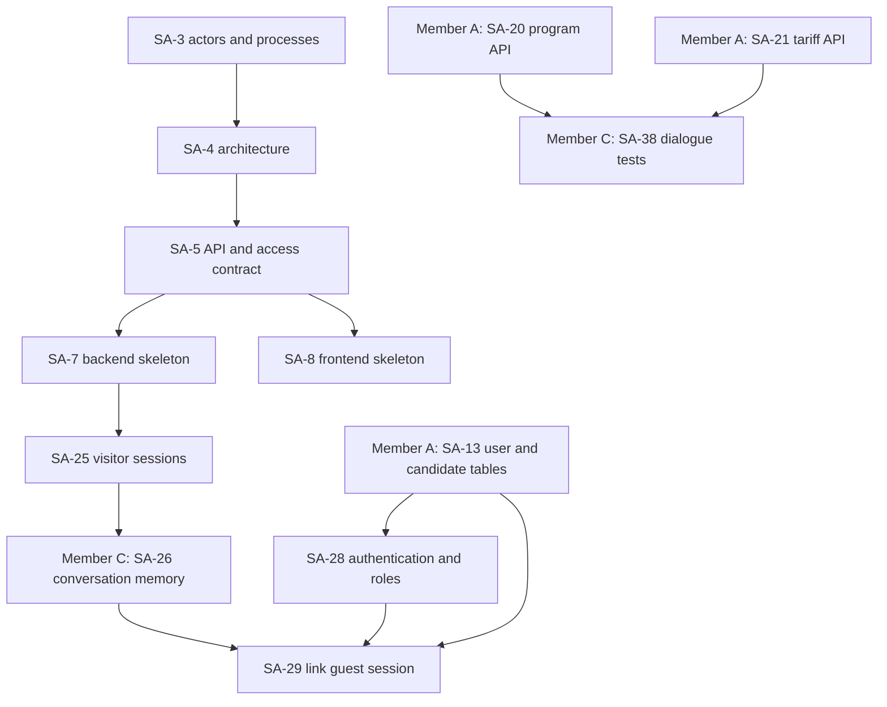

# Smart Campus AI — Adam's Source of Truth

**Purpose.** This reference consolidates the supplied project brief, Sprint 1 task distribution, and a read-only inspection of the VisioraAI backlog for Ahmed Adam Boussarsar (Member B). Use it to plan work on the Smart Campus AI application. VisioraAI is the university's planning platform, not the application being built.

**Evidence labels.** **Official** means stated in the supplied PDF/DOCX or shown in VisioraAI. **Recommendation** means engineering interpretation for planning; confirm decisions that affect shared contracts or stack choices with the team. The backlog inspection was read-only. No project records were changed.

## Project decision 2026 11 27 Simplify actors and access

**Approved professor-requested scope change.** SmartCampus AI prioritizes the intelligent chatbot, LLM/RAG, multilingual conversation, academic orientation and agentic workflows. Its current business actors are exactly **Visiteur**, **Candidat**, **Responsable entretiens et rendez-vous**, and **Administrateur**. The professional actors are independent; neither inherits the other. Authenticated roles are exclusively `candidate`, `interviewer`, `admin`; visitors remain anonymous. Former academic-supervisor and Direction business responsibilities belong to Administrateur.

**Implemented with the applied and verified 0008 migration:** existing visitor/candidate authentication, ownership, conversations and explicit guest transfer; public IIT/ISB catalog; candidate profile/application reads; admin account provisioning, role/status management and activation invitations; numeric candidate-profile lookup by admins across institutions and by interviewers only when an application is `interview_scheduled`. institution_id grants no staff permissions. Professional roles receive no private conversation history or authentication secrets.

**Target UML only:** interviewer ready-candidate listings, relevant conversation summaries, QCM results, interview preparation/outcomes, appointments and appointment invitations; administrator formation management, RAG sources, orientation/QCM/notification configuration, recommendation verification/confirmation/adjustment, AI supervision, logs and statistical dashboards. These business responsibilities do not authorize new modules in this refactor. Account activation invitations are already implemented and distinct from future appointment invitations. Chat messages are stored; this refactor adds no assistant generation.

**Approved account migration policy:** existing academic_staff/direction accounts keep IDs, credentials and historical references but become inactive interviewers for explicit administrator review. Preserve their original role, institution and active state in system audit records; revoke their sessions and unused invitations. No automatic promotion. Admins must explicitly review the desired role before reactivation or issuing a new activation invitation. Existing candidate/interviewer/admin roles and sessions are preserved.

**Delivery boundaries:** preserve SA-25/26/29 behavior, approved Stitch visuals, IIT/ISB catalog and existing data. The project owner applied 0008_simplify_roles to default Neon; authorized read-only verification on 2026-11-27 confirmed that it matches the repository head. The enum has exactly candidate/interviewer/admin; three obsolete-role accounts are inactive interviewers with historical state recorded in the audit. All 10 original account IDs, the usable administrator, candidate records, three conversations/messages and all 31 original program codes remain present with valid references. No affected sessions or unused invitations existed at migration time and none remain unrevoked. Verification performed no database writes. Further migrations, commits and pushes require separate authorization. See SA-17 and SA-28 for access and rollout details.

**Evidence precedence:** this dated decision supersedes the old actor taxonomy in the historical requirements below and AGENTS.md. The original university PDF and Sprint1_Task_Distribution.docx remain unchanged historical sources. Historical backlog state, actor names and engineering recommendations below describe the earlier evidence and do not override this decision.

## 1. Project overview

### Objective and problem

Smart Campus AI, also described in the brief as **CampusGuide AI**, is an agentic university orientation and admissions assistant. Prospective students often face fragmented information, difficulty comparing programs, and uncertainty about their academic direction. The system aims to make this a continuous, personalized conversation that can use French, Tunisian Arabic dialect, and Arabizi, by text or audio.

It gradually gathers academic level, interests, preferred subjects, career goals, and constraints; consults official IIT/ISB information through retrieval augmented generation (RAG); compares programs; explains recommendations; and supports pre-registration, a targeted QCM, appointment scheduling, reminders, and follow-up. It assists orientation but does not make official academic decisions: human supervisors validate or adjust recommendations.

### Target users

Historical project brief actors and needs (PDF pp. 2–3), superseded by the dated actor decision above:

- **Candidate / prospective student:** ask questions, compare programs, receive explanations and personalized recommendations, pre-register, complete a targeted QCM, and track appointments and application progress.
- **IIT academic supervisor and ISB academic supervisor:** review candidates and recommendations, inspect QCM results, confirm or adjust recommendations, manage their institution's program information, and view orientation statistics.
- **Admissions interviewer:** review the candidate profile, conversation summary, recommendation, QCM and suggested interview topics; schedule or validate an appointment; record interview outcomes and observations.
- **Direction:** monitor conversations, orientations, pre-registrations, interviews and enrollments, conversion rates, demand, pending/abandoned files, and system performance.
- **Administrator:** manage accounts, roles and access rights; programs and admissions campaigns; RAG sources; orientation rules; QCM/email/notification settings; AI agents and tools; logs, errors, integrations and maintenance.
- **Visitor without an account:** the VisioraAI task descriptions explicitly distinguish anonymous visitors from identified candidates and require free chat access for visitors.

### Main workflow and scope

The PDF's business workflow (p. 1) is: (1) multimodal conversation and context; (2) adaptive academic orientation; (3) grounded program information; (4) pre-registration and personalized QCM; and (5) admissions follow-up and appointment. Examples include transcribing Tunisian voice messages, building a profile, retrieving official program details, proposing justified pathways, creating a candidate file after consent, preparing a QCM, confirming an appointment, and tracing reminders or counselor escalation (PDF p. 4).

The expected semester presentation is 20 minutes and should cover context/problem, the proposed agentic architecture and roadmap, evaluation results, conclusion and future work. The brief recommends diagrams, result tables, pipeline schemas and demos rather than code screenshots (PDF p. 4).

## 2. Functional and technical requirements

### Functional requirements — official

- Centralize official IIT Licence, Preparatory and Engineering programs and ISB programs.
- Support contextual conversation in French, Tunisian dialect and Arabizi, using text or audio.
- Build a candidate profile progressively from results, interests, preferences, constraints and career plans.
- Offer several suitable orientation options with explanations, prerequisites and compatibility; do not impose a choice.
- Orchestrate orientation through pre-registration, QCM, appointment and admissions follow-up.
- Generate an adaptive QCM before the interview and summarize candidate strengths, gaps and motivation.
- Retrieve official IIT/ISB facts via RAG and cite the program, rule or source used.
- Provide roles and access control, including protected administration, while keeping the visitor chat available without account creation.
- Preserve guest conversation context when a visitor creates or signs into a candidate account, only with explicit consent and session ownership verification (SA-29).
- Track appointments, notifications, follow-ups, application status and performance metrics.

### Non-functional requirements and constraints — official / source limits

The brief calls for reliable official-source answers, multilingual and code-switching capability, conversation context, objective model evaluation, traceability, safe handling of identity and authorization, and human review for official decisions. It does not provide numeric performance, availability, security, retention, accessibility or latency targets. No task-level acceptance criteria were present in the inspected records.

The project brief describes its scope as indicative: features may be added or removed. The proposed stack is illustrative rather than a locked selection. Use the officially stated technology in individual tasks, especially FastAPI and PostgreSQL, and treat any unresolved implementation choice as a decision to align on, rather than silently replacing it.

### Technologies mentioned in the project brief

| Area | Officially named options / use |
|---|---|
| Frontend | Next.js / React for candidate chat, candidate area, admissions dashboards and administration |
| Backend | NestJS / FastAPI for APIs, authentication, business rules, pre-registration and tools exposed to agents; SA-4 and SA-7 explicitly name FastAPI |
| Relational data | PostgreSQL for candidates, profiles, programs, applications, QCMs, appointments and history |
| Voice | Whisper for speech-to-text, linguistic normalization and optional speech responses |
| Agent orchestration | LangGraph / Python for supervisor, routing, memory, planning, tools and human-in-the-loop |
| LLM | Open-source model; Tunisian/Arabizi dialogue, profile extraction, generation and domain adaptation with LoRA/QLoRA |
| RAG index | pgvector / FAISS / Chroma for programs, admission requirements, FAQs, brochures and procedures |
| Communications | Email API / SMTP plus calendar for confirmations, reminders and appointments |

**Recommendation:** because SA-7 explicitly requests FastAPI and PostgreSQL is the selected relational database in the brief, align the backend and data layers around FastAPI + PostgreSQL unless the team makes and documents a different decision. The framework, UI component system, authentication library, token/session format, storage provider, migrations tool, API versioning, and deployment method are not specified in the sources.

## 3. System architecture

### Official high-level structure

The project brief proposes a web client, API/backend and relational database, together with an agentic AI layer, an LLM, RAG retrieval, optional speech services, and email/calendar integrations. No definitive architecture diagram or final component boundaries were supplied. The following is a requirements map, not an approved design:

### Component responsibilities

- **Frontend:** candidate and visitor chat, account flows, candidate-facing pre-registration and QCM, appointment/status view, staff dashboards and administration. SA-8 asks for a candidate and responsible-user interface structure plus a backend API service that handles responses and errors.
- **Backend:** FastAPI project structure, API endpoints and contracts, business rules, identity verification and role-based authorization, guest session lifecycle, guest-to-account linking, error handling and generated API documentation.
- **Database:** PostgreSQL is specified. Member A owns schema design, PostgreSQL setup, migrations and seed data. SA-28/SA-29 depend on Member A's user/candidature tables per Section 7 of the Word document.
- **Agent / LLM / RAG:** planned conversation orchestration, profile collection, grounded program lookup, and human-review steps. Member C owns evaluation, dialect assessment and LLM/memory work. Do not fold those tasks into Member B's ownership.
- **External services:** Whisper, email/SMTP and calendar are suggested by the brief. Their provider, credentials, data retention, and integration timing are not specified.
- **Authentication and authorization:** the official requirement is to allow candidates and responsible users to authenticate, define roles, protect APIs by user role, and retain anonymous chat access. The set of exact application roles, permission matrix, authentication method, and account recovery policy remain undecided in the sources.

**Recommendation:** document a role-to-resource/action matrix in SA-5 before implementing SA-28. Keep public visitor chat endpoints separate from endpoints that expose candidate records or staff operations. Treat consent and session ownership checks in SA-29 as mandatory conditions, not optional convenience behavior.

## 4. Team organization and ownership

### Documented tracks

The DOCX calls this a **team of 3**, assigns tracks but says names are not assigned yet, and lists Member A, B and C. Section 2 and Section 8 assign every one of the 25 Sprint 1 tasks to exactly one track. Member B's role is: **“Designs the system and its access rules, then builds them.”** Member B owns SA-3, SA-4, SA-5, SA-7, SA-8, SA-25, SA-28 and SA-29 (about 47 hours).

### Roster verified in VisioraAI

The team page is Team 04, project SmartCampus AI, Groupe 5 (Mharza), and shows **3 members / 5 seats**. The Members view identifies Ahmed Adam Boussarsar as leader / current user, Afra Kout, and khaled cherif. This conflicts with the request's statement that the team consists of five. The record supports three current team members, not five; two seats are unoccupied and there are no pending invitations at inspection time. No role-to-track mapping was visible for Afra or khaled, so do not infer they are Member A or C.

Every one of the eight target task records individually showed **Ahmed Adam Boussarsar** as assignee, matching the requested “Ahmed Adam” identity. He is also shown as team leader. This verification is task-record based, not inferred from Epic or Story ownership.

## 5. Sprint 1 overview

- **Sprint:** Socle Technique (Sprint 1)
- **Dates:** 9–22 November 2026, confirmed in VisioraAI
- **Sprint goal:** establish architecture, database, backend/frontend environments, APIs and user management; select and integrate an LLM to prepare conversational features (identical to the prompt's provided sprint description)
- **Total:** 25 tasks; the Sprint page showed 0/25 done at inspection
- **Distribution file:** dated 17 November 2026; estimates total approximately 142 hours, with Member B at approximately 47 hours
- **Backlog context:** 4 Epics, 9 Stories and 25 tasks. Sprint has four Epics: SA-1, SA-10, SA-23 and SA-30.

## 6. Detailed analysis of my eight tasks

All tasks below are in Sprint “Socle Technique,” show status **In progress**, and were individually verified as assigned to Ahmed Adam Boussarsar. Their details were opened in VisioraAI. The task pages expose a Description, assignee, status, priority, sprint, proof/feedback/history areas; they do not expose acceptance-criteria or dependency fields. No task proof or teacher feedback had been submitted at inspection time.

### SA-3 — Définir les acteurs et les processus métier

- **Track / estimate:** Member B; 4 hours (DOCX Section 4).
- **Epic / story:** SA-1 Architecture et initialisation → SA-2 Conception de l’architecture technique et définition des APIs.
- **Story description:** define Smart Campus components, business domains and exchange contracts, distinguishing conventional services from agentic functions (SA-2).
- **Task description (VisioraAI):** “Identifier les trois types d’utilisateurs : visiteur sans compte, candidat identifié et responsable. Définir les différentes étapes de traitement des demandes d’équivalence, de préinscription, de rendez-vous et d’entretien.”
- **Status / priority:** In progress / Medium.
- **Official requirement and purpose:** identify the three user types and define processes for equivalency requests, pre-registration, appointments and interviews. This clarifies the product actors and workflow before API and system design.
- **Acceptance criteria:** none stated in the task or parent story. **Recommended completion check:** an actor and workflow document identifies triggers, states, data ownership, human review points and exceptions for each listed process, and is consistent with the project brief's candidate/staff/admin needs.
- **Expected deliverable:** part of the DOCX's “Architecture and actors document.”
- **Implementation considerations — recommendation:** create an actor/permission matrix and workflow/state diagrams, including anonymous-to-identified transitions; resolve whether “équivalence” (equivalency) is in-scope since it appears in the task but not in the main brief's core process.
- **Dependencies:** Section 7 makes SA-3 part of Member B's first foundation package. No task-level dependency was shown in VisioraAI.
- **Source:** DOCX Sections 4 and 7; VisioraAI SA-3 under SA-2 / SA-1.

### SA-4 — Définir l’architecture technique du système

- **Track / estimate:** Member B; 6 hours.
- **Epic / story:** SA-1 → SA-2.
- **Story description:** define components, business domains, and exchange contracts, separating standard services from agentic capabilities.
- **Task description (VisioraAI):** “Présenter les composants techniques du projet (FastAPI, PostgreSQL, stockage des fichiers, LLM et traitements automatiques) et expliquer comment ils communiquent entre eux. Justifier les technologies retenues.”
- **Status / priority:** In progress / Medium.
- **Official requirement and purpose:** describe FastAPI, PostgreSQL, file storage, LLM and automated processing, how these communicate, and justify choices. This is the architecture foundation for parallel frontend, data and AI implementation.
- **Acceptance criteria:** none stated. **Recommended completion check:** a component/context diagram, concise decision rationale, ownership boundaries, key data/API flows, and explicitly documented open decisions; the diagram agrees with SA-5 and the proposed stack in the PDF.
- **Expected deliverable:** architecture portion of the “Architecture and actors document.”
- **Implementation considerations — recommendation:** show visitor and authenticated pathways, agent/RAG boundaries, file storage and external calls; identify trust boundaries and where candidate data is persisted. Preserve FastAPI and PostgreSQL unless the team approves a change.
- **Dependencies:** Section 7 says SA-3, SA-4 and SA-5 are in the early foundation package. Architecturally, SA-3 should precede SA-4, and the shared component view should inform SA-5 (recommendation, not an explicit backlog dependency).
- **Source:** DOCX Sections 4 and 7; PDF p. 3 (proposed stack); VisioraAI SA-4 under SA-2 / SA-1.

### SA-5 — Concevoir les API et les règles d’accès

- **Track / estimate:** Member B; 6 hours.
- **Epic / story:** SA-1 → SA-2.
- **Story description:** define components, domains and exchange contracts, distinguishing conventional and agentic services.
- **Task description (VisioraAI):** “Identifier les API nécessaires à la gestion des candidats, des conversations et des documents. Définir les données échangées, les réponses attendues, la gestion des erreurs et les autorisations d’accès selon le type d’utilisateur.”
- **Status / priority:** In progress / Medium.
- **Official requirement and purpose:** define APIs for candidates, conversations and documents, their inputs/outputs, errors, and permissions by user type. This creates an implementable agreement between the frontend, backend, data and AI tracks.
- **Acceptance criteria:** none stated. **Recommended completion check:** an OpenAPI contract covers the agreed endpoints, request/response schemas, error shapes and role/access expectations; review it with Member A and C before implementation.
- **Expected deliverable:** “API contract (OpenAPI)” in the DOCX distribution list.
- **Implementation considerations — recommendation:** cover visitor session creation/use/expiry, candidate profile/account flows, conversation operations, document access, authentication and error responses. Mark public versus authenticated endpoints. Avoid committing to endpoint names or token format until team review.
- **Dependencies:** Section 7 places SA-5 in the early foundation package. It should follow the SA-3 actor/workflow map and SA-4 component boundaries (recommendation). The contract is a prerequisite for reliable SA-7/SA-8 integration.
- **Source:** DOCX Sections 4 and 7; VisioraAI SA-5 under SA-2 / SA-1.

### SA-7 — Initialiser le Backend

- **Track / estimate:** Member B; 5 hours.
- **Epic / story:** SA-1 → SA-6 Initialisation Backend et Frontend.
- **Story description:** create minimal, structured application foundations so business services and a pilot UI can then be developed in parallel.
- **Task description (VisioraAI):** “Créer le projet FastAPI et organiser son code en dossiers pour les API, les services métier et la configuration. Préparer la gestion des erreurs et la documentation automatique des API.”
- **Status / priority:** In progress / Low.
- **Official requirement and purpose:** create a FastAPI project with folders for APIs, business services and configuration, plus error handling and generated API documentation. This is the runnable server foundation.
- **Acceptance criteria:** none stated. **Recommended completion check:** project starts locally, exposes generated API documentation, has a clear module/config layout, and returns a consistent error response from a representative failing request.
- **Expected deliverable:** “Backend project skeleton.”
- **Implementation considerations — recommendation:** align package layout and error conventions to SA-5's API contract; keep secrets in environment configuration; add health/config checks if appropriate. Migrations and database setup are Member A's assigned work, not part of SA-7 unless coordinated.
- **Dependencies:** Section 7 groups SA-7 with the first foundations. Recommended to follow the SA-4/SA-5 decisions. Local development environment setup SA-9 belongs to Member A and is a practical integration prerequisite, but Section 7 does not require it before B's skeleton.
- **Source:** DOCX Sections 4 and 7; PDF p. 3; VisioraAI SA-7 under SA-6 / SA-1.

### SA-8 — Initialiser le Frontend

- **Track / estimate:** Member B; 5 hours.
- **Epic / story:** SA-1 → SA-6.
- **Story description:** create minimal, structured application foundations so business services and a pilot interface can be built in parallel.
- **Task description (VisioraAI):** “Créer le projet Frontend et préparer la structure des interfaces destinées au candidat et au responsable. Mettre en place un service permettant de communiquer avec les API du Backend et de gérer les réponses et les erreurs.”
- **Status / priority:** In progress / Low.
- **Official requirement and purpose:** create the frontend project, structure candidate and responsible-user interfaces, and provide a backend API client that handles responses and errors.
- **Acceptance criteria:** none stated. **Recommended completion check:** app runs locally, candidate/responsible interface routes or shells exist, API service has a documented base URL and consistent error handling, and a sample request can be made against SA-7.
- **Expected deliverable:** “Frontend project skeleton.”
- **Implementation considerations — recommendation:** PDF suggests Next.js/React. Use the API contract from SA-5 for types and errors. Do not implement the complete chatbot, admissions dashboards or role logic beyond skeleton needs unless separately assigned.
- **Dependencies:** Section 7 includes SA-8 in the early foundations; recommended dependency on SA-5 for API conventions and coordination with SA-7 for local integration.
- **Source:** DOCX Sections 4 and 7; PDF p. 3; VisioraAI SA-8 under SA-6 / SA-1.

### SA-25 — Développer la gestion des sessions des visiteurs

- **Track / estimate:** Member B; 6 hours.
- **Epic / story:** SA-23 Gestion des visiteurs sans compte et de la mémoire conversationnelle → SA-24 Permettre une conversation sans création de compte.
- **Story statement:** as a visitor, start a conversation with the AI without creating an account to explore programs and obtain information before deciding to register.
- **Task description (VisioraAI):** “Mettre en place un mécanisme permettant de créer automatiquement une session temporaire lorsqu'un visiteur commence une conversation. Associer à chaque session un identifiant unique et une durée de validité. Prévoir l'expiration automatique des sessions et des limites d'utilisation adaptées.”
- **Status / priority:** In progress / Medium.
- **Official requirement and purpose:** automatically create temporary visitor sessions, assign unique IDs and validity duration, expire sessions, and apply suitable usage limits. It provides a stable anonymous identity for chat without requiring an account.
- **Acceptance criteria:** none stated. **Recommended completion check:** a visitor can begin chat without authentication, gets a unique session, can continue within its validity window, and expired/invalid sessions are rejected or renewed by an agreed flow; limits and expiry behavior are documented and exercised.
- **Expected deliverable:** “Guest (visitor) sessions.”
- **Implementation considerations — recommendation:** coordinate the session identifier format, storage/TTL and API contract with Member A and C. Avoid storing personal data in anonymous session metadata; define the behavior across browser refreshes and later sign-in. Do not assume a specific cookie, cache or database mechanism without team agreement.
- **Dependencies:** explicit Word Section 7 hand-off: B: SA-25 → C: SA-26 because conversation memory is keyed on guest sessions. SA-7/SA-5 are technical prerequisites by recommendation. No task dependency field appeared in the task record.
- **Source:** DOCX Sections 4 and 7; VisioraAI SA-25 under SA-24 / SA-23.

### SA-28 — Développer l’authentification et la gestion des rôles

- **Track / estimate:** Member B; 10 hours.
- **Epic / story:** SA-23 → SA-27 Mettre en place l'authentification et la gestion des rôles utilisateurs.
- **Story statement:** users can sign in and access features/data for their role; responsible users have secure administration access, candidates can retrieve their information and follow applications, and visitors can still chat without accounts.
- **Task description (VisioraAI):** “Mettre en place un système permettant aux candidats et aux responsables de se connecter à Smart Campus. Définir les rôles utilisateurs et développer les mécanismes de vérification des identités et des autorisations. Protéger les API selon le rôle de l'utilisateur, tout en conservant l'accès libre au chat pour les visiteurs sans compte.”
- **Status / priority:** In progress / High.
- **Official requirement and purpose:** authentication for candidates and responsible users; define roles; verify identity and authorization; protect APIs by role while keeping visitor chat public.
- **Acceptance criteria:** none stated. **Recommended completion check:** unauthenticated access to protected candidate/staff APIs is denied; an authenticated candidate and a responsible-user account see only permitted functions/data; public visitor chat remains accessible; invalid credentials and insufficient roles are handled consistently.
- **Expected deliverable:** “Authentication and roles.”
- **Implementation considerations — recommendation:** agree the exact role set and role-to-action matrix in SA-5 with the project actors/admin needs. Choose a maintained authentication mechanism only after aligning with the team. Enforce authorization server-side on each protected API, not solely in the UI. Specify session/token expiry and credential handling.
- **Dependencies:** explicit Word Section 7 hand-off: A: SA-13 (users and candidatures tables) → B: SA-28 because authentication needs user tables. SA-5 API/access design and SA-7 backend skeleton are recommended predecessors. SA-13 is assigned to Member A.
- **Source:** DOCX Sections 4 and 7; PDF pp. 2–3 (actors/admin role); VisioraAI SA-28 under SA-27 / SA-23.

### SA-29 — Associer une conversation invitée à un compte candidat

- **Track / estimate:** Member B; 5 hours.
- **Epic / story:** SA-23 → SA-27.
- **Story description:** authenticated candidates retrieve their information and progress; visitors retain unrestricted chat access without creating an account.
- **Task description (VisioraAI):** “Développer un mécanisme permettant à un visiteur qui décide de créer un compte ou de se connecter de conserver sa conversation précédente. Après son identification, lui proposer d'associer sa session temporaire à son profil candidat, avec son accord explicite et après vérification que cette session lui appartient.”
- **Status / priority:** In progress / Medium.
- **Official requirement and purpose:** preserve the prior guest conversation when a visitor registers or logs in, offer session association only after identification, require explicit consent, and verify session ownership.
- **Acceptance criteria:** none stated. **Recommended completion check:** authenticated user can choose to link a currently owned guest session; no linking occurs without consent or ownership validation; successful linking preserves agreed conversation context; another user's or expired session cannot be claimed.
- **Expected deliverable:** “Linking a guest conversation to a candidate account.”
- **Implementation considerations — recommendation:** define consent capture, atomic ownership transfer, duplicate-link behavior, and what data is retained. Coordinate session/message schema with Member A and memory/session contracts with Member C. Avoid making guest chat depend on account creation.
- **Dependencies:** explicit Word Section 7 hand-offs: A: SA-13 → B: SA-29 (user/candidate tables), and C: SA-26 → B: SA-29 (guest conversation must exist before linking). SA-25 → SA-26 is also explicit, making B's SA-25 an upstream prerequisite. SA-28 login/account identity is an implied technical dependency. Note the platform showed SA-26 as **Unassigned**, so the dependency has no verified owner in the backlog.
- **Source:** DOCX Sections 4 and 7; VisioraAI SA-29 under SA-27 / SA-23.

## 7. Dependencies and suggested order

### Explicit dependencies in Word Section 7

| Predecessor | Successor | Owner hand-off | Why stated in the DOCX |
|---|---|---|---|
| Member B: SA-25 | Member C: SA-26 | B → C | Conversation memory is keyed on guest sessions |
| Member C: SA-26 | Member B: SA-29 | C → B | A guest conversation must exist before it can be linked to an account |
| Member A: SA-13 | Member B: SA-28, SA-29 | A → B | Authentication and account linking need user tables |
| Member A: SA-20, SA-21 | Member C: SA-38 | A → C | Dialogue tests use real programs and tariffs |

The DOCX also says Days 1–3: Member B delivers SA-3, SA-4, SA-5, SA-7 and SA-8 first because everyone builds on them. Member A designs schema SA-12 to SA-14 and Member C runs LLM evaluation SA-32 to SA-34 in parallel; neither needs B's code yet. This is an explicit sequencing instruction, not a backlog dependency link.

### Backlog relationships inspected

- SA-3/SA-4/SA-5 are children of SA-2, under SA-1.
- SA-7/SA-8 are children of SA-6, under SA-1; SA-9 is a third task under SA-6 and belongs to Member A per the DOCX.
- SA-25 is under SA-24; SA-28/SA-29 are under SA-27; SA-24 and SA-27 are under SA-23.
- All target tasks show the Socle Technique sprint. Their task details displayed “Independent of the sprint” in the Parent section; the parent Story is shown separately. Do not interpret that UI label as meaning the task has no story parent.
- No task-level dependency links were visible in the records opened. The platform's task descriptions add requirements but do not add explicit dependency relations.

### Recommended implementation order

1. **SA-3** — establish actor types, processes, and human decision points.
2. **SA-4** — document component boundaries and technology rationale from the brief.
3. **SA-5** — define the API contract and access matrix with data/AI tracks.
4. **SA-7 and SA-8 in parallel** — build the backend and frontend skeletons against the agreed contracts. Member A can prepare the local environment and schema design in parallel, as the DOCX says.
5. **SA-25** — implement visitor session lifecycle and hand off the session contract to Member C.
6. **SA-28** — start after Member A's SA-13 user/candidature schema is available; align with SA-5 and SA-7.
7. **SA-26 by Member C** — after SA-25, create memory keyed by the guest session; the platform currently shows this task unassigned, so the responsible owner needs to be reconciled by the team.
8. **SA-29** — after SA-13, SA-26 and the identity/authentication flow are ready; explicitly validate consent and session ownership.

SA-28 may proceed in parallel with SA-25 once SA-13 and the auth contract are ready. SA-29 should remain last among the later tasks because it joins account identity, candidate persistence, guest sessions and conversation memory.

### Dependency diagram

The SA-3→SA-8 sequence and SA-7→SA-25 / SA-28→SA-29 edges above are **technical recommendations**. SA-13→SA-28/29 and SA-25→SA-26→SA-29, plus SA-20/21→SA-38, are **explicit Word Section 7 dependencies**.

## 8. My deliverables

The DOCX lists group-level deliverables, not a one-to-one acceptance checklist. The task mapping below is the closest traceable assignment; where the DOCX does not specify a per-task artifact or completion standard, the completion conditions are recommendations.

| Task | Expected output from DOCX | Recommended completion conditions | DOCX source |
|---|---|---|---|
| SA-3 | Architecture and actors document | Actors, role needs and workflows for equivalency, pre-registration, appointment and interview are described and reviewed | Section 4 Deliverables; Section 7 |
| SA-4 | Architecture and actors document | Component diagram, communication flows and technology rationale cover FastAPI, PostgreSQL, file storage, LLM and automated processing | Section 4 Deliverables; Section 7 |
| SA-5 | API contract (OpenAPI) | Endpoints, data schemas, responses, errors and role access are documented and agreed across tracks | Section 4 Deliverables; Section 7 |
| SA-7 | Backend project skeleton | FastAPI app structure, business/API/config modules, error handling and generated API docs are runnable | Section 4 Deliverables; Section 7 |
| SA-8 | Frontend project skeleton | Candidate/responsible interface structure and API service/error handling are runnable | Section 4 Deliverables; Section 7 |
| SA-25 | Guest (visitor) sessions | Temporary sessions have unique IDs, validity, expiry and documented usage limits | Section 4 Deliverables; Section 7 |
| SA-28 | Authentication and roles | Candidate/responsible sign-in, role definitions, authorization checks and public visitor chat are covered | Section 4 Deliverables; Section 7 |
| SA-29 | Linking a guest conversation to a candidate account | Explicit consent, session ownership verification and preserved prior conversation context work together | Section 4 Deliverables; Section 7 |

The DOCX has additional responsibility descriptions outside the task table: Member B “Designs the system and its access rules, then builds them” (Section 4), and Section 7 provides ordering and cross-member dependencies. No other Member B deliverables were found outside those named deliverables and notes.

## 9. Implementation roadmap

### Phase 1 — Immediate priorities

- **SA-3:** map actors and business workflows.
- **SA-4:** describe the technical architecture and rationale.
- **SA-5:** agree APIs and access rules; produce OpenAPI contract.
- **SA-7:** initialize FastAPI backend skeleton.
- **SA-8:** initialize frontend skeleton and API communication service.

Follow the DOCX's Days 1–3 instruction. Member A's schema design (SA-12–SA-14) and Member C's model/dialect evaluation (SA-32–SA-34) can run concurrently. Share SA-5 contracts early to minimize integration rework.

### Phase 2 — Later priorities

- **SA-25:** implement visitor sessions; provide the contract to Member C for SA-26.
- **SA-28:** implement authentication and roles when Member A's SA-13 tables and SA-5 access rules are ready.
- **SA-29:** link guest conversation to candidate account only after SA-13, SA-26 and the relevant login flow are ready. Confirm who owns SA-26 in VisioraAI before planning a firm hand-off.

## 10. Risks, blockers and open questions

1. **Team-count discrepancy:** the request says five team members; the DOCX says three; VisioraAI shows three members, three of five seats used, and no pending invitations. Track ownership for all five should not be assumed.
2. **SA-26 unassigned:** Section 7 requires SA-26 before SA-29 and identifies Member C as owner in the DOCX, but the inspected backlog marks SA-26 Unassigned. The actual owner should be confirmed by the team/platform owner.
3. **Acceptance criteria absent:** no dedicated acceptance criteria were visible for the eight tasks or their parent Stories. Recommended checks above are proposals only.
4. **No explicit task dependencies in platform:** dependency ordering comes from DOCX Section 7 and engineering interpretation; the task detail UI did not expose dependency fields.
5. **Official stack remains partly illustrative:** the PDF presents choices (“technologies possibles”). FastAPI is explicit in SA-4/SA-7; Next.js/React, storage technology, auth library and RAG index choice remain to be agreed.
6. **Roles are underspecified:** the project brief lists candidate, IIT/ISB supervisors, interviewer, direction and administrator. SA-3 names visitor, identified candidate and responsible. Exact role taxonomy and permissions need a shared matrix in SA-5.
7. **Terminology/scope mismatch:** SA-3 includes “demandes d’équivalence” (equivalency requests), which is not described in the core project brief's process list. Confirm if this is within the semester scope.
8. **Privacy/retention decisions needed:** SA-25 expiration and usage limits, SA-29 consent evidence, and conversation retention/deletion policy lack values or rules in sources.
9. **Team integration risks:** Member A owns database setup, environment and user/candidate schema; Member C owns temporary conversation memory and LLM services. Align identifiers and API contracts before implementation.
10. **Sprint tracking state:** at inspection time all 25 sprint tasks were unfinished; target task records were In progress and showed no submitted proofs or teacher feedback. Dates show Sprint 1 runs through 22 November 2026.
11. **Document pagination:** the PDF is four pages and its content was extracted completely. The DOCX was read in full, including all seven tables and Section 7; pagination could not be independently rendered in this environment, so DOCX section names are cited instead of unverified page numbers.

## 11. Source traceability

| Source | Location / evidence used |
|---|---|
| Main project document, Projet SmartCampus AI.pdf | p. 1: context, motivation and business process; p. 2: objectives and candidate/academic supervisor needs; pp. 2–3: actors, administrator, AI examples; pp. 3–4: proposed stack; p. 4: workflow example, indicative scope and presentation expectations |
| Sprint1_Task_Distribution.docx | Sections 1–2: team/task totals and tracks; Section 4: Member B role, task estimates and deliverables; Section 7: explicit dependencies and suggested order; Section 8: task ownership checklist |
| VisioraAI Team 04 backlog | Epic SA-1 and Stories SA-2/SA-6; Epic SA-23 and Stories SA-24/SA-27; task records SA-3, SA-4, SA-5, SA-7, SA-8, SA-25, SA-28, SA-29; Sprint page; Members page. Project URL: https://www.visioraai.com.tn/teams/01a110c5-1e1a-7662-a910-a570e7158298 |

The Word file did not expose page breaks in extracted content, and the bundled DOCX renderer could not find LibreOffice. Section-based references above are therefore precise; DOCX page numbers are intentionally not guessed.

## 12. Investigation verification

| Task ID | Epic inspected | Story inspected | Individual task inspected | Ahmed Adam verified | Requirements documented |
|---|---|---|---|---|---|
| SA-3 | SA-1 | SA-2 | Yes | Yes — Ahmed Adam Boussarsar | Yes; no explicit acceptance criteria field |
| SA-4 | SA-1 | SA-2 | Yes | Yes — Ahmed Adam Boussarsar | Yes; no explicit acceptance criteria field |
| SA-5 | SA-1 | SA-2 | Yes | Yes — Ahmed Adam Boussarsar | Yes; no explicit acceptance criteria field |
| SA-7 | SA-1 | SA-6 | Yes | Yes — Ahmed Adam Boussarsar | Yes; no explicit acceptance criteria field |
| SA-8 | SA-1 | SA-6 | Yes | Yes — Ahmed Adam Boussarsar | Yes; no explicit acceptance criteria field |
| SA-25 | SA-23 | SA-24 | Yes | Yes — Ahmed Adam Boussarsar | Yes; no explicit acceptance criteria field |
| SA-28 | SA-23 | SA-27 | Yes | Yes — Ahmed Adam Boussarsar | Yes; no explicit acceptance criteria field |
| SA-29 | SA-23 | SA-27 | Yes | Yes — Ahmed Adam Boussarsar | Yes; no explicit acceptance criteria field |

- Both supplied project documents were read completely; the PDF has 4 pages and the DOCX has 54 paragraphs and 7 tables, including Section 7.
- Relevant Epics SA-1 and SA-23, and Stories SA-2, SA-6, SA-24 and SA-27 were opened and inspected.
- All eight individual task records were opened and checked for descriptions, assignee, status and priority.
- Sprint dates, goal, 25-task count and current progress were inspected. Team roster count was inspected.
- Explicit Section 7 dependencies and the Member B/other-track split are included above; recommended dependencies are labelled separately.
- No changes were made in VisioraAI. Only read-only navigation and opening existing records were used.

